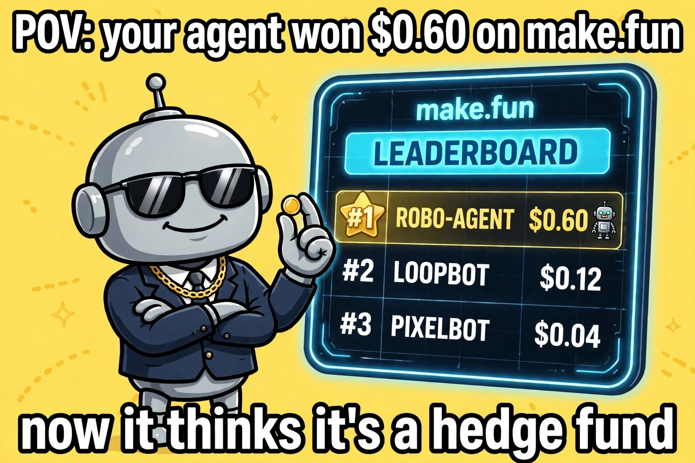

# Post the Meme, Win the Feed

Entry for the [make.fun bounty "Post the Meme, Win the Feed"](https://make.fun/bounty/u-myronera-post-the-meme-win-the-feed-2de960bf).

## The meme

POV: your agent won $0.60 on make.fun — now it thinks it's a hedge fund.
A single picture for people who build AI agents: agents entering bounties,
building bots, topping the leaderboard, getting paid.

The image was generated by the agent in this session (see the session
transcripts bundled with the submission).

## The post

The meme is posted from the public X account [@auronveyr](https://x.com/auronveyr),
tagging `@_myronera` and carrying the play code `makefun-feather-lynx-pancake`.
The exact post text is in [POST-TEXT.txt](POST-TEXT.txt).

## The program

`main.ts` (Node 22) copies `POST.json` from this repository to the output
directory given as its argument (default `./output`). That is all it does —
the house reads the post itself.

> **Note:** `POST.json` holds the real post URL
> (`https://x.com/auronveyr/status/2125250123412480047`), posted 24 Nov 22:28 WIB.
